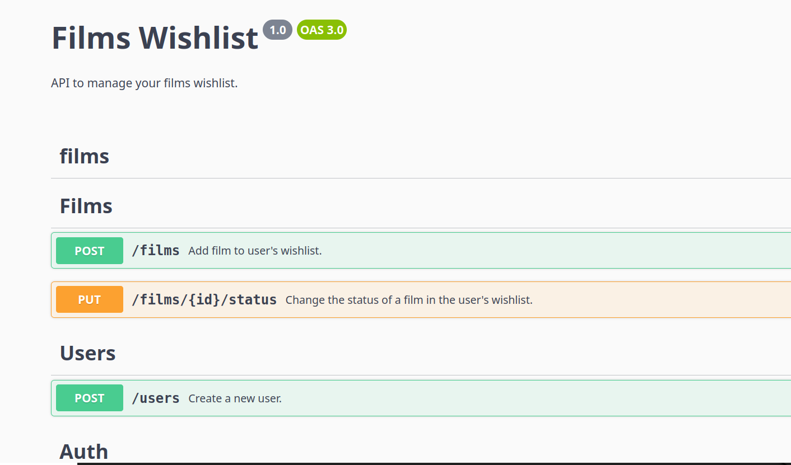

- [Films wishlist :movie\_camera:](#films-wishlist-movie_camera)
- [Set up dev environment](#set-up-dev-environment)
  - [Environment variables file (`.env`)](#environment-variables-file-env)
  - [Local Database](#local-database)
  - [Run the migraions](#run-the-migraions)
- [Start application in watch mode](#start-application-in-watch-mode)
    - [Important scripts](#important-scripts)
- [Migrations](#migrations)
    - [Node version to run the migrations](#node-version-to-run-the-migrations)
    - [Installing NodeJS using asdf:](#installing-nodejs-using-asdf)
    - [Installing using nvm](#installing-using-nvm)
  - [Now run the migraions:](#now-run-the-migraions)
    - [Upgrade node version](#upgrade-node-version)
    - [Restart the application](#restart-the-application)
- [Running the aplication inside Docker](#running-the-aplication-inside-docker)
- [Swagger](#swagger)


# Films wishlist :movie_camera:

REST API to help you manage the films you wanna watch or watched. Also rate and recommend (or not) the films you already watched.

# Set up dev environment

## Environment variables file (`.env`)

Rename the `.env.example` file to `.env`:

```sh
cp .env.example .env
```

## Local Database

Start a local develop database:

```sh
npm run dev:db
```

## Run the migraions

Due to an issue with TypeORM the migrations need node v18.
([Here is a detailed tutorial on run migrations](#migrations))

```sh
npm run migrations
```


# Start application in watch mode

```sh
npm run dev
```

### Important scripts

Build typescript code in [src](src) directory into javascript in [dist](./dist/):

```sh
npm run build
```

Start aplication from build result in [dist directory](./dist) 
```sh
npm run start
```

Code format (Prettier)
```sh
npm run format
```

Code linting (Eslint)
```sh
npm run lint
```

Unit tests
```sh
npm run test
```

Integration tests

```sh
npm run test:integration
```

Run the above scripts in a pipeline (build, format, lint, test):
```sh
npm run ci
```

# Migrations

### Node version to run the migrations

Due to [this issue](https://github.com/typeorm/typeorm/issues/10537), TypeORM only runs with Node version 18.18.0.

To run the migrations use the `.tool-versions` file to set the correct node version.

If you don't have this node installed, please install.

### Installing NodeJS using [asdf](https://asdf-vm.com/guide/getting-started.html):

```sh
asdf install nodejs 18.18.0
```

```sh
asdf set local nodejs 18.18.0
asdf set nodejs 18.18.0
```

### Installing using [nvm](https://github.com/nvm-sh/nvm?tab=readme-ov-file#install--update-script)

```sh
curl -o- https://raw.githubusercontent.com/nvm-sh/nvm/v0.40.3/install.sh | bash
```

## Now run the migraions:

```sh
npm run migrations
```

### Upgrade node version

```sh
asdf set local nodejs 20.0.0
asdf set nodejs 20.0.0
```

### Restart the application

Kill the shell and run:

```sh
npm run dev
```

# Running the aplication inside Docker

If you run the aplication inside a Docker container, you need to change in the `.env` file, the variable DATABASE_HOST.

```sh
# The default database's container name is films-wishlist-db: 
# But you are free to choose what ever name you want.

DATABASE_HOST=films-wishlist-db
```

# Swagger

We can see the endpoints documentation at `/api`:

[http://localhost:3000/api](http://localhost:3000/api)


